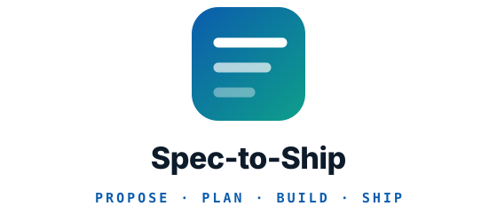

<p align="center">
  <picture>
    <source media="(prefers-color-scheme: dark)" srcset="assets/logo-dark.svg">
    
  </picture>
</p>

<p align="center"><em>Run a product the way a good team would: agree what to build, plan it in sprints a client can
follow, build each ticket test-first, gate the build with QA, and ship it. On any stack.</em></p>

<p align="center">
  <a href=".claude-plugin/plugin.json"></a>
  <a href="LICENSE"></a>
  
  <a href="https://github.com/kratagyaagarwal2262/spec-to-ship/actions/workflows/validate.yml"></a>
  
</p>

**Docs:** [Install](#install) · [Commands](#commands) · [Project delivery](#project-delivery) ·
[Agent loop](#the-agent-loop) · [Agents](agents/README.md) · [Changelog](CHANGELOG.md)

**Let your agent install it:** point it at [INSTALL.md](INSTALL.md).

---

Skills and agents for **running** a product rather than improvising it: settle the requirement,
write the proposal, cut the backlog, plan the sprints, build each ticket test-first, gate every
build with QA, sort the feedback, and keep the project's memory in the repo and its tickets in
GitHub. Used on one change it is just the engineering loop: understand the code, design the change,
build it, prove it, ship it.

Spec-to-Ship names no stack. It reads each component's commands from the project's own config, and
reaches a stack through a **stack kit** when one is installed. [Flutterbase](https://github.com/kratagyaagarwal2262/flutterbase)
is the stack kit for Flutter and Supabase; any kit that fills the same slots works.

Every skill is small, readable, and adapts to the project it finds. Nothing here owns your process;
you compose the parts you want.

Built from what worked across a run of real apps, and from public skill sets
([pstack](https://github.com/cursor/plugins/tree/main/pstack) and
[mattpocock/skills](https://github.com/mattpocock/skills)).

## Install

Spec-to-Ship installs **once for your user**, not into each project, and works with Claude Code, Codex,
opencode, Antigravity and Cursor, alone or side by side.

### 1. Get it

**Let your agent do it.** In any of the five harnesses, say:

> Install Spec-to-Ship for me by following
> https://raw.githubusercontent.com/kratagyaagarwal2262/spec-to-ship/main/INSTALL.md

It detects which harnesses you have, asks which you want, installs, and checks the result.

**Or do it yourself:**

```bash
# Codex, opencode, Antigravity, Cursor: any combination
curl -fsSL https://raw.githubusercontent.com/kratagyaagarwal2262/spec-to-ship/main/install.sh | bash -s -- --for codex,cursor

# every harness found on this machine
curl -fsSL https://raw.githubusercontent.com/kratagyaagarwal2262/spec-to-ship/main/install.sh | bash -s -- --detect
```

```text
# Claude Code installs as a managed plugin, from inside Claude Code
/plugin marketplace add kratagyaagarwal2262/spec-to-ship
/plugin install spec-to-ship@kratagyaagarwal
```

Including `claude` in `--for` runs those two commands for you when the `claude` CLI is on your PATH.

| Harness | Skills | Commands (human-started skills) | Agents | Hooks |
|---|---|---|---|---|
| Claude Code | plugin | native | native | native |
| Codex | `~/.agents/skills` | kept manual by each skill's `agents/openai.yaml` | converted to TOML | `~/.codex/hooks.json` |
| opencode | `~/.agents/skills` | `/name` commands behind a permission prompt | converted | global plugin |
| Antigravity | `~/.gemini/config/skills` | not supported: the agent may start any skill | native | none: no prompt hook |
| Cursor | `~/.agents/skills` | native | native | `~/.cursor/hooks.json` |


Codex, opencode and Cursor read one shared folder, so installing for all three costs one copy. Run
`kit doctor` (in `~/.spec-to-ship/bin`) any time to see what each harness loads and whether a skill shows up
twice. `kit uninstall` removes exactly what was installed and keeps your own settings.
`install/harnesses.json` is the registry of these paths.

**Updating.** `kit update` installs the latest release for every harness you already have, then
prints what changed since your version, including any **Migration** step a project needs. Restart
the harness afterwards. In Claude Code, `/plugin` updates the plugin; `kit update` runs that too
when `claude` is on your PATH. The install line always fetches the latest release; add
`--version vX.Y.Z` to stay on one.

### 2. Run `/fk-setup`

Once per project, before any other command. It will:

- Explore the repo and ask only the few things it cannot observe
- Record the project's **Components table**: each component, its commands, and the stack kit serving it
- Write `docs/agents/project.md`, a `CLAUDE.md`, and an `AGENTS.md` twin for every other harness
- Start the project's memory vault in `docs/vault/`, and set up GitHub Issues as its tracker
- Audit the repo first if it was inherited

Every other skill reads `docs/agents/project.md`, which is what makes one kit serve many projects.

### 3. That's it

Type `/ask-kit` whenever you are unsure what comes next: it reads where the project stands and names the step.

---

## Why this exists

Four failures, each one the reason for a group of skills.

### #1. We built the wrong thing

**The problem.** The expensive failure is almost never bad code. It is the right code for the wrong
requirement. You read the brief, you think you understood it, you build for a week, and then it
turns out something else was meant. The gap was never in the implementation. It was in the
conversation before it.

**The fix** is to front-load alignment, before there is code to throw away:
[`grill`](./skills/grill/SKILL.md) interviews you until every undefined state has an answer,
[`domain-glossary`](./skills/domain-glossary/SKILL.md) settles the words, and
[`to-spec`](./skills/to-spec/SKILL.md) writes it down including what is *out* of scope. On client
work, [`client-questionnaire`](./skills/client-questionnaire/SKILL.md) asks the things only they
can answer. `/fk-plan` runs them in that order.

### #2. We wrote code before we knew the shape

**The problem.** Straight from a ticket to a keyboard. The types get invented while typing, the
seams land where the first draft happened to put them, and the design is whatever the code settled
into. Every later change fights it.

**The fix** is to decide the shape while it is still text.
[`plan-change`](./skills/plan-change/SKILL.md) sketches the types, signatures and boundaries with
no bodies, and records hard-to-reverse decisions as ADRs.
[`engineering-principles`](./skills/engineering-principles/SKILL.md) is the vocabulary for choosing
between two shapes. [`explain`](./skills/explain/SKILL.md) comes first when the code is not yours.

### #3. We said done without proving it

**The problem.** "Done" degrades into "it compiles and the happy path looked fine." Nobody ran the
error state. Nobody checked it against the spec, only against taste.

**The fix** is to build test-first and to name your evidence.
[`tdd`](./skills/tdd/SKILL.md) writes the failing test before the code, and
[`verify`](./skills/verify/SKILL.md) makes you **name the rung** you actually reached.
[`code-review`](./skills/code-review/SKILL.md) and
[`security-audit`](./skills/security-audit/SKILL.md) answer *is it written well* separately from
*does it work*.

### #4. The thread got lost between sessions

**The problem.** The decision made on Tuesday is gone by Thursday, the next session starts cold, and
nobody knows which command comes next.

**The fix** is memory that lives in the repo and a handoff after every step.
[`project-memory`](./skills/project-memory/SKILL.md) keeps a small vault of plain Markdown, and
[`next-step`](./skills/next-step/SKILL.md) ends every command with the next command, what it does,
and the text to paste.

---

## Two tracks

### The engineering loop

The default. Each step's output is the next step's input, and each command calls the skills it
needs, so the only thing to remember is where you are.

| # | Step | Command |
|---|---|---|
| 1 | Configure the repo, once | `/fk-setup` |
| 2 | Understand what is there | `explain` |
| 3 | Settle the requirement, write the spec, sketch the shape | `/fk-plan` |
| 4 | Build it test-first, review it, prove it, commit | `/fk-build` |
| 5 | Prove the release is safe and ship it | `/fk-release` |
| 6 | Make the next round shorter | `/retro` |

`/fk-plan` runs `grill`, the stack's design slot (once per app), `to-spec` and `plan-change`.
`/fk-build` builds each slice through the stack kit's build slot, or `tdd` where none is installed,
then drives every component's checks, `code-review`, `security-audit` and `verify` to a commit.
`/fk-release` runs `release-readiness`, `setup-ci` where no CI exists, and each component's
release slot.

**Pairing with a stack kit.** Spec-to-Ship's commands and method skills work on any stack and read each
component's commands from `docs/agents/project.md`. A stack kit installed beside it answers for the
component through `project-stack`'s slots (`<kit>-setup`, `-conventions`, `-design`, `-build`,
`-verify`, `-release`). With none installed, Spec-to-Ship falls back to the component's own commands.

### Project delivery

The engineering loop, run as a project: a proposal everything is measured against, a feature list
the client prioritises, a pointed backlog in GitHub Issues, short sprints, a QA gate before anyone outside the team sees a build, and
feedback sorted into bugs and change requests against what was agreed. It suits client work and
your own product alike; a one-off change needs only the loop above.

| # | Step | Command |
|---|---|---|
| 1 | Configure the repo, its memory and its tracker, and audit it if inherited | `/fk-setup` |
| 2 | Write the proposal and the feature list, the design language, the screens and their flows, and the current phase's backlog | `/fk-plan` |
| 3 | Plan the sprint: one whole user flow, onboarding first, split by screen when it will not fit | `/fk-sprint plan` |
| 4 | Build each ticket to a reviewed, proven pull request | `/fk-build #N` |
| 5 | Test the merged build before it leaves the team | `/fk-sprint qa` |
| 6 | Send the build to the client or testers | `/fk-release` |
| 7 | Sort what comes back into bugs, change requests and questions | `/fk-feedback` |
| ‒ | Off the plan at any point: a detour, a new data store, a design rework | `/fk-change` |
| 8 | Close the sprint, record its velocity, improve the kit | `/fk-sprint close`, `/retro` |
| 9 | Acceptance testing, then the store | `/fk-sprint uat`, `/fk-release` |

**Each planning document has one job,** which is what tells the planning skills apart:

| Document | Holds | Written by |
|---|---|---|
| `docs/vault/proposal.md` | Why, for whom, the modules, out of scope, the timeline. What the client signs | `project-proposal` |
| `docs/vault/features.md` | Every agreed feature (`M2.3`), its user flow, its priority (Must, Should, Could) and its phase, grouped by flow in delivery order. What sprints are picked from, one flow each | `project-proposal` |
| `docs/specs/NN-*.md` | One feature's acceptance criteria and decisions, where it needs more than a ticket | `to-spec` |
| `docs/vault/screens/` | Every screen as a short `.screens` file, rendered free into one `index.html` with the user flows. What the client sees before anything is built | `screen-flows` |
| A ticket | One buildable slice: its criteria, or the spec criteria it delivers, its points, its feature and its screens | `project-backlog` |
| `docs/vault/sprints/sprint-NN.md` | The features a sprint promised, and what happened | `/fk-sprint` |

`grill` writes nothing of its own: it settles the answers the others write down. Not sure which
step you are on? `/ask-kit` reads these files and names it.

**Where you start changes the first steps, not the rest.** A new app runs every step. Your own
existing app skips the scaffold: `/fk-plan` writes a proposal for the next phase, or `/fk-build`
takes a single change straight away. An inherited app gets an audit from `/fk-setup` before anyone
estimates anything, and its first sprint stabilises what the audit found.

**Memory and tickets each live in one place.** Every command reads only the vault's index and
`memory.md` at the start, opens anything else at the step that needs it, and leaves a log entry at
the end: the proposal, module notes, sprint notes, feedback rounds and a short `memory.md`, all plain
Markdown that Obsidian opens as a vault. A script checks each file against a budget at session
start, and `prune-context` cuts the vault and the agent docs back when one is over, and at every
sprint close. Anything only you will read, such as a review, a decision or a message to paste to a
client, stays in the chat.

**Every command ends with the next one.** Its last lines name the next command, what it does, the
exact text to paste, and whether it waits on you. Ticket status lives only in GitHub
Issues, with milestones as sprints and labels for points, modules and state.

---

## The agent loop

Once a sprint is planned, agents can build it while you do something else. `kit loop run` is a
plain script, so watching costs nothing; a model runs only when there is something new to judge.

```
ticket ready → builder opens a PR → CI (no model) ─ red ─→ builder fixes ─┐
                                       │                                   │
                                     green → reviewer ─ changes ─→ builder fixes
                                                │
                                             approves → ready-for-human → you test and merge → cleanup
```

- **Each model run is short and fresh:** its own headless process, capped in dollars or minutes,
  with the diff and the ticket handed to it rather than searched for.
- **Cheap by default, stronger on evidence:** the builder starts on the cheapest model in its ladder
  and climbs only for an 8-point ticket, a second red CI run, or a second round of review. A
  stronger reviewer runs only when a change crosses a one-way door (stored data, app identity,
  permissions, an external contract).
- **The reviewer comes from another model family** than the builder, so they do not miss the same
  things.
- **Start-up is the hidden cost.** A fresh headless run loads the harness's whole system prompt
  before doing anything: measured on Claude Code's smallest model, about $0.07 cold and $0.01 with
  a warm prompt cache. So reviews run back to back to share that cache, and MCP servers are left out
  of review runs.
- **It stops and hands over** after three review rounds, three CI fixes or the pull request's
  budget, labelled `ready-for-human` and `agent-stuck`, with a desktop notification.
- **State lives on the pull request** (labels and one marker comment), so any machine can pick it
  up. `kit loop status` lists each one and what it has cost.
- **`kit loop run --until-done`** keeps going until every ticket waits on you, then prints one entry
  per pull request (verdict, review rounds, CI fixes, cost, what is left for you to judge), the
  tickets it could not build, the ones blocked until you merge, and what to run next.

**You choose the models, through your agent.** The kit names none: `install/roles.json` says what
each kind of work needs (explore, build, review, judge, qa). The `configure-models` skill checks
what you can reach and today's prices, proposes a model per role for every harness you use, proves
each one answers, and saves your approved choice with `kit models set`, which pins it everywhere.
After a sprint, `kit models report` shows what each role cost, and the skill proposes changes
backed by those numbers.

Each role runs as its own process, so roles can use different harnesses: a builder in opencode on
one provider and a reviewer in Claude Code, say. Claude Code's headless run is verified; the others'
are written from their documentation and stay off until you probe them and opt in.


## Reference

**Commands** are what you type. They cost nothing in context until used, and each one calls the
skills its job needs, in order. **Background skills** hold the reusable discipline: the commands
reach them, and the agent can also reach for one on its own when a request clearly needs it. A
command may call background skills, but never another command.

### Commands

The work starts here. Every other skill is reached through one of these.

- **[fk-setup](./skills/fk-setup/SKILL.md)**: Configure a repo for the engineering kit: its
  components and the stack kit serving each, the project config, the memory vault and the tracker.
  Run once per project before using the other skills.
- **[fk-plan](./skills/fk-plan/SKILL.md)**: Turn an idea, a brief or a client's request into an
  agreed proposal, a prioritised feature list, drawn screens and a pointed backlog, or a single
  requirement into a spec and a sketch, settling it before any code exists.
- **[fk-sprint](./skills/fk-sprint/SKILL.md)**: Run the sprint, from planning it out of the ready
  tickets and reporting where it stands, through gating its build with QA before anyone outside sees
  it, to closing it with velocity and a review, or running the final acceptance window.
- **[fk-build](./skills/fk-build/SKILL.md)**: Build a ticket, spec or sketch to a reviewed, verified
  commit, choosing the path from what it is given: a change to existing code, a new feature from a
  design and an endpoint, or a screen before its API exists.
- **[fk-feedback](./skills/fk-feedback/SKILL.md)**: Sort a round of client or tester feedback into
  bugs, change requests and questions against the agreed proposal, file each one, and draft the
  reply.
- **[fk-change](./skills/fk-change/SKILL.md)**: Take a request the planned process does not
  cover, such as a detour mid-sprint, a new data store or a rework of the design language, map
  which plans and tickets it changes, and update each through its owner in order so the backlog and
  the sprint still describe the app being built.
- **[fk-release](./skills/fk-release/SKILL.md)**: Get a release ready to ship: find what it could
  break and prove the fact its safety rests on, confirm CI gates every component, and produce what
  each component ships, store pack included, through its stack's release steps.
- **[retro](./skills/retro/SKILL.md)**: After a round of work, propose improvements to the kit and
  the project's agent environment so the next round is shorter.
- **[ask-kit](./skills/ask-kit/SKILL.md)**: Ask where the project stands and which kit command or
  skill comes next. A router over every skill in the engineering kit.

### Tools

Commands for moving work between sessions and models, and for prose others will read.

- **[handoff](./skills/handoff/SKILL.md)**: Compact the current conversation into a handoff document
  another session can pick up.
- **[spec-for-cheap-executor](./skills/spec-for-cheap-executor/SKILL.md)**: Write one
  self-contained task doc for work that leaves this session with nobody reviewing it before it
  lands, such as another team or a model in a tool someone else runs.
- **[unslop](./skills/unslop/SKILL.md)**: Cut AI tells from any writing. Must always apply.

### Deliver

Running the work as a project. These name no framework: they hold the process, and the commands connect it to the engineering skills below.

- **[project-proposal](./skills/project-proposal/SKILL.md)**: Write or revise the project's proposal
  in docs/vault/proposal.md, covering objective, users, deliverables, modules, technical approach,
  assumptions, what the client provides, out of scope and timeline, under a revision history, and
  its feature list in docs/vault/features.md, each feature prioritised and phased.
- **[project-backlog](./skills/project-backlog/SKILL.md)**: Break the current phase's features into
  tickets with acceptance criteria, story points, screen IDs and blocking edges, and file them in
  the tracker, writing a module note only where a module has decisions of its own.
- **[screen-flows](./skills/screen-flows/SKILL.md)**: Draw every screen a feature or a phase needs,
  with its states and the user flow between screens, as short .screens files a script renders into
  one HTML page for the user and the client to review in a browser, in place of design frames.
- **[project-tracker](./skills/project-tracker/SKILL.md)**: File, move and report on the project's
  tickets, modules and sprints in its issue tracker, following docs/agents/issue-tracker.md.
- **[project-memory](./skills/project-memory/SKILL.md)**: Read and keep the project's memory vault
  in docs/vault/, deciding what to read at the start of a session, which file each kind of fact
  belongs in, and how to write without overwriting another agent.
- **[prune-context](./skills/prune-context/SKILL.md)**: Cut the project's docs and agent context to
  what is still true and still read, by folding session logs into memory, deleting finished change
  notes and old sprint notes, shrinking the specs of shipped features, and removing lines from
  CLAUDE.md, AGENTS.md and docs/agents/ that are stale, repeated or already enforced.
- **[next-step](./skills/next-step/SKILL.md)**: Say where the project stands and what to run next,
  naming the command or skill, what it does, the exact prompt to paste, and what it needs from the
  person first. Use at the end of every kit command, when a task finishes, or when the user asks
  what to do next, which command comes next or where the project stands.
- **[project-stack](./skills/project-stack/SKILL.md)**: Resolve the project's components (an app, a
  backend, a database) and, for one of them, its stack, its commands and the stack kit that serves
  it, then hand the request to that kit's skill when it is installed.

### Understand

Working out what the code does, and what it should do, before changing it.

- **[client-questionnaire](./skills/client-questionnaire/SKILL.md)**: Turn decisions you cannot make
  in-house into a questionnaire for the client to fill in.
- **[to-spec](./skills/to-spec/SKILL.md)**: Turn the current conversation into a written spec, with
  an explicit out-of-scope section.
- **[explain](./skills/explain/SKILL.md)**: Explain how a feature, subsystem or codebase actually
  works, and why it was built that way.
- **[grill](./skills/grill/SKILL.md)**: Interview the user until a feature's requirements are
  settled.
- **[domain-glossary](./skills/domain-glossary/SKILL.md)**: Build and sharpen the project's shared
  vocabulary in GLOSSARY.md, and record hard-to-reverse decisions as ADRs.
- **[takeover-audit](./skills/takeover-audit/SKILL.md)**: Audit an inherited codebase before
  committing to work on it, covering whether it builds, what its tests prove, how far it has
  drifted, where the risk sits, and what must be stabilised first.

### Design

Deciding the shape of a change while it is still cheap to change.

- **[plan-change](./skills/plan-change/SKILL.md)**: Design a change before writing
  it: the types, signatures and module boundaries it needs, and the order the work lands in.
- **[engineering-principles](./skills/engineering-principles/SKILL.md)**: Five principles that
  change how a change is shaped rather than what it does: root causes, subtraction, reader load,
  modelling the domain in types, and designing for the agent that changes it next.

### Build

Writing the code. `/fk-build` is the entry point: it builds each slice through the stack kit's build slot, or `tdd` where none is installed.

- **[tdd](./skills/tdd/SKILL.md)**: Build a change test-first in thin vertical slices: a failing
  test at a named seam, seen to fail for the intended reason, then the smallest code that passes it.
  The test tool and layout come from the component's conventions.

### Prove

Separating *does it work* from *is it written well*, and answering both out loud.

- **[pr](./skills/pr/SKILL.md)**: Shape a pull request body for fast human review: the smallest
  visual that shows the change, before-and-after evidence that it works, and how dangerous it is to
  merge.
- **[verify](./skills/verify/SKILL.md)**: Prove a change actually works before calling it done, by
  climbing a ladder of verification rungs in each component it touches and naming the rung reached.
- **[code-review](./skills/code-review/SKILL.md)**: Review changes on two independent axes: does the
  code follow the project's conventions and its stack's review baseline, and does it do what the
  spec asked.
- **[diagnose-bug](./skills/diagnose-bug/SKILL.md)**: Disciplined diagnosis loop for hard bugs,
  jank, and regressions.
- **[security-audit](./skills/security-audit/SKILL.md)**: Audit a change or a codebase for security
  across secrets, authentication and authorisation, input handling, data at rest and in transit,
  dependencies, and logging of personal data, adding each component's platform checks from its stack
  kit.


### Keep it working

The work that stops a codebase decaying between features.

- **[merge-conflicts](./skills/merge-conflicts/SKILL.md)**: Resolve merge and rebase conflicts by
  intent, including the generated files and lockfiles that must be regenerated rather than merged.

### Ship

Everything between "it works on my machine" and "it is live".

- **[setup-ci](./skills/setup-ci/SKILL.md)**: Generate a CI pipeline that runs every component's
  install, check and test commands on every push, then its build.
- **[release-readiness](./skills/release-readiness/SKILL.md)**: Before shipping to a live app, find
  what a change could break elsewhere and prove the one fact its safety depends on by running code.
- **[setup-wizard](./skills/setup-wizard/SKILL.md)**: Generate an interactive script that walks a
  human through setup steps only they can perform, such as provisioning credentials, store accounts,
  or signing.

### Working across sessions and models

Handing work to another session, a cheaper model, or a teammate.

- **[triage-executor-bugs](./skills/triage-executor-bugs/SKILL.md)**: Diagnose and route bugs found
  after a cheap model executed a spec-for-cheap-executor task doc. Batches bug reports, finds root
  causes (which usually cluster), then routes each one to inline repair, a mechanical fix doc for
  the cheap executor, or an amendment to the original spec.
- **[configure-models](./skills/configure-models/SKILL.md)**: Choose which model each kind of kit
  agent work runs on, in every harness the user has, from what they can actually reach, today's
  prices and benchmarks, and their budget, then save it with kit models set.

### Meta

Configuring the kit and editing it.

- **[writing-for-agents](./skills/writing-for-agents/SKILL.md)**: How to write documents agents
  consume: skills, CLAUDE.md, and any doc reached by a pointer.

## Agents

Specialists the skills delegate to: `codebase-explorer` for read-only search, `solution-architect`
for design decisions and root causes, and the `qa-engineer` that `/fk-sprint` sends to test a
sprint's build. Layer engineers come from the stack kit. See [agents/README.md](./agents/README.md).

## What the kit assumes

Very little. The **Components table** in `docs/agents/project.md` records what each part of the
project is, how it is built, tested and released, and which stack kit serves it. A project with no
stack kit installed still runs every command, using the commands the table lists.

## Editing the kit

Read `writing-for-agents` first. `scripts/kit.py` is the installer and `install/harnesses.json` is
the one list of supported harnesses. Then the rule that keeps this portable: **a project fact never
goes in a skill.** If it is true of one project but not of every project, it belongs in
`docs/agents/project.md`, and **no skill names a stack**. `CLAUDE.md` in this repo carries the
authoring conventions. Run `python3 scripts/validate-kit.py` before committing: it checks that every
skill appears in this README with a description matching its frontmatter, that nothing names a
stack, and that the installer and loop work.

## Credits

The alignment skills adapt `grilling`, `to-questionnaire`, `to-spec`, `domain-modeling`,
`code-review`, `diagnosing-bugs`, `tdd`, `wizard`, `handoff`, `writing-for-agents`, `retro` and
`pr` from **mattpocock/skills** (MIT); `pr` there credits Dex Horthy's `show-me` skill from
[humanlayer/skills](https://github.com/humanlayer/skills). The verification ladder,
`release-readiness`, the harness generator and the principles adapt `create-verification-skill`,
`prove-it-works`, `blast-radius`, `hillclimb`, `unslop` and the principle set from **pstack** (MIT).
Both are worth reading in full.
